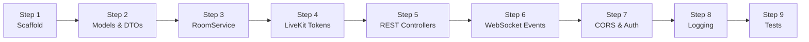

# Phase 1: Java Backend Foundation — Step-by-Step Plan

> **Status: COMPLETED & VERIFIED (18/18 Automated Tests Passing)** ✅
> **Goal:** A working Spring Boot API that creates rooms, manages join/approve flows, generates LiveKit tokens, and pushes live status over WebSocket.

---

## Your Environment

| Tool | Version |
|------|---------|
| Java | OpenJDK 25 (Homebrew) — fully compatible with Spring Boot 3.x |
| Maven | 3.9.12 |
| LiveKit SDK | `io.livekit:livekit-server:0.10.1` |

---

## Step 1 — Scaffold the Spring Boot Project

> Create the Maven project structure under `funtouch/server/`

**What we'll generate:**
- `pom.xml` with Java 21+ target, Spring Boot 3.4.x parent
- Dependencies: `spring-boot-starter-web`, `spring-boot-starter-websocket`, `spring-boot-starter-validation`, `livekit-server`
- Package: `com.funtouch`
- `application.yml` with LiveKit config (read from env vars)

**Files created:**
```
server/
├── pom.xml
├── src/main/java/com/funtouch/
│   └── FunTouchApplication.java
├── src/main/resources/
│   └── application.yml
└── src/test/java/com/funtouch/
    └── FunTouchApplicationTests.java
```

**Checkpoint:** `mvn clean compile` passes ✅

---

## Step 2 — Define the Domain Model

> Build the `Room` entity and supporting enums/DTOs

**Classes to create:**

| Class | Purpose |
|-------|---------|
| `Room` | Core model — id, name, host info, guest list, status, control state, timestamps |
| `Participant` | Nested record — id, name, role (`HOST`/`GUEST`), connection status |
| `RoomStatus` | Enum — `WAITING`, `ACTIVE`, `ENDED` |
| `ControlState` | Enum — `NONE`, `REQUESTED`, `GRANTED`, `REVOKED` |
| `CreateRoomRequest` | DTO — host display name |
| `JoinRoomRequest` | DTO — guest display name |
| `ControlRequest` | DTO — guestId, action (grant/revoke) |
| `RoomResponse` | DTO — room details + token (when applicable) |

**Files created:**
```
src/main/java/com/funtouch/
├── model/
│   ├── Room.java
│   ├── Participant.java
│   ├── RoomStatus.java
│   └── ControlState.java
└── dto/
    ├── CreateRoomRequest.java
    ├── JoinRoomRequest.java
    ├── ControlRequest.java
    └── RoomResponse.java
```

**Checkpoint:** `mvn compile` passes ✅

---

## Step 3 — Build `RoomService` (In-Memory Storage)

> Core business logic with `ConcurrentHashMap<String, Room>`

**Key methods:**

| Method | What it does |
|--------|-------------|
| `createRoom(hostName)` | Generates a short room ID (e.g., `abc123`), stores room, returns it |
| `getRoom(roomId)` | Lookup by ID, throws `RoomNotFoundException` if missing |
| `requestJoin(roomId, guestName)` | Adds guest as `PENDING`, notifies host via WebSocket |
| `approveGuest(roomId, guestId)` | Marks guest as `APPROVED`, notifies guest via WebSocket |
| `rejectGuest(roomId, guestId)` | Removes guest, notifies via WebSocket |
| `grantControl(roomId, guestId)` | Sets control state to `GRANTED` for that guest |
| `revokeControl(roomId, guestId)` | Sets control state to `REVOKED` |
| `endRoom(roomId)` | Sets status to `ENDED`, cleans up |

**Also create:**
- `RoomNotFoundException` → maps to HTTP 404
- `GlobalExceptionHandler` (`@RestControllerAdvice`) for clean error responses

**Files created:**
```
src/main/java/com/funtouch/
├── service/
│   └── RoomService.java
└── exception/
    ├── RoomNotFoundException.java
    └── GlobalExceptionHandler.java
```

**Checkpoint:** Unit test `RoomServiceTest` — create a room, join, approve, grant control ✅

---

## Step 4 — LiveKit Token Generation

> Use the LiveKit Java SDK to generate access tokens

**Create `LiveKitTokenService`:**

| Method | Token Permissions |
|--------|-------------------|
| `generateHostToken(roomId, hostName)` | `canPublish`, `canSubscribe`, `canPublishData` (screen share + data) |
| `generateGuestToken(roomId, guestName, canControl)` | `canSubscribe`, conditionally `canPublishData` (only if control is granted) |

**Configuration via `application.yml`:**
```yaml
livekit:
  api-key: ${LIVEKIT_API_KEY}
  api-secret: ${LIVEKIT_API_SECRET}
  url: ${LIVEKIT_URL:wss://your-project.livekit.cloud}
```

**Files created:**
```
src/main/java/com/funtouch/
├── service/
│   └── LiveKitTokenService.java
└── config/
    └── LiveKitProperties.java      (@ConfigurationProperties)
```

**Checkpoint:** Generate a token and decode it at [jwt.io](https://jwt.io) to verify claims ✅

---

## Step 5 — REST Controllers

> Wire up the HTTP endpoints

### Endpoints

| Method | Path | What it does | Returns |
|--------|------|-------------|---------|
| `POST` | `/api/rooms` | Create room | `{ roomId, roomUrl, token }` |
| `POST` | `/api/rooms/{id}/join` | Guest requests join | `{ message: "waiting for approval" }` |
| `POST` | `/api/rooms/{id}/approve` | Host approves guest | `{ guestToken }` |
| `POST` | `/api/rooms/{id}/reject` | Host rejects guest | `{ message }` |
| `POST` | `/api/rooms/{id}/control` | Grant/revoke control | `{ controlState }` |
| `GET`  | `/api/rooms/{id}` | Get room info | `{ room details }` |
| `DELETE` | `/api/rooms/{id}` | End room | `{ message }` |

**Validation:**
- `@NotBlank` on display names
- `@Valid` on request bodies
- Room ID path variable validated in service layer

**Files created:**
```
src/main/java/com/funtouch/
└── controller/
    └── RoomController.java
```

**Checkpoint:** Test all endpoints with `curl` or Postman ✅

---

## Step 6 — WebSocket for Live Events

> Push real-time status updates to connected clients

**Events pushed over WebSocket:**

| Event | When | Sent to |
|-------|------|---------|
| `GUEST_JOINED` | Guest requests to join | Host |
| `GUEST_APPROVED` | Host approves | Guest |
| `GUEST_REJECTED` | Host rejects | Guest |
| `CONTROL_GRANTED` | Host grants control | Guest |
| `CONTROL_REVOKED` | Host revokes control | Guest |
| `ROOM_ENDED` | Room closed | All |

**Architecture:** Spring WebSocket with STOMP over SockJS
- Endpoint: `/ws`
- Topic per room: `/topic/room/{roomId}`
- Clients subscribe to their room topic on connect

**Files created:**
```
src/main/java/com/funtouch/
├── config/
│   └── WebSocketConfig.java
├── dto/
│   └── WebSocketEvent.java
└── service/
    └── (update RoomService to publish events via SimpMessagingTemplate)
```

**Checkpoint:** Open two browser tabs → create room in one → join in the other → see the event arrive in real time ✅

---

## Step 7 — CORS & Security Configuration

> Allow the frontend to call the API

**`CorsConfig.java`:**
- Allow origins: `http://localhost:5173` (Vite dev server), plus your production domain
- Allow methods: `GET`, `POST`, `DELETE`, `OPTIONS`
- Allow headers: `Content-Type`, `Authorization`
- Allow credentials: `true`

**Basic security (no auth framework yet):**
- Simple session-token header (`X-Host-Token`) returned on room creation
- Host-only endpoints (`/approve`, `/reject`, `/control`, `/delete`) require this token
- Stored in the `Room` object, validated in a `HandlerInterceptor`

**Files created:**
```
src/main/java/com/funtouch/
└── config/
    ├── CorsConfig.java
    └── HostAuthInterceptor.java
```

**Checkpoint:** Frontend on `localhost:5173` can call the API without CORS errors ✅

---

## Step 8 — Logging & Error Handling

> Structured logging for debugging the full pipeline

- **SLF4J + Logback** (included with Spring Boot)
- Log every room lifecycle event at `INFO` level
- Log token generation (without secrets) at `DEBUG` level
- Log errors/exceptions at `ERROR` level with stack traces
- Add `logback-spring.xml` for JSON-formatted logs (optional, useful for production)

**Checkpoint:** Tail the logs while hitting endpoints — every action leaves a clear trace ✅

---

## Step 9 — Tests

> Verify everything works before moving to Phase 2

| Test | Type | What it covers |
|------|------|---------------|
| `RoomServiceTest` | Unit (JUnit 5 + Mockito) | Create, join, approve, control, edge cases |
| `LiveKitTokenServiceTest` | Unit | Token generation, correct permissions |
| `RoomControllerTest` | Integration (`@WebMvcTest`) | HTTP status codes, validation errors, JSON shape |
| `WebSocketIntegrationTest` | Integration (`@SpringBootTest`) | Event delivery over STOMP |

**Files created:**
```
src/test/java/com/funtouch/
├── service/
│   ├── RoomServiceTest.java
│   └── LiveKitTokenServiceTest.java
└── controller/
    └── RoomControllerTest.java
```

**Checkpoint:** `mvn test` → all green ✅

---

## Final File Tree After Phase 1

```
server/
├── pom.xml
├── src/
│   ├── main/
│   │   ├── java/com/funtouch/
│   │   │   ├── FunTouchApplication.java
│   │   │   ├── config/
│   │   │   │   ├── CorsConfig.java
│   │   │   │   ├── LiveKitProperties.java
│   │   │   │   ├── WebSocketConfig.java
│   │   │   │   └── HostAuthInterceptor.java
│   │   │   ├── controller/
│   │   │   │   └── RoomController.java
│   │   │   ├── dto/
│   │   │   │   ├── CreateRoomRequest.java
│   │   │   │   ├── JoinRoomRequest.java
│   │   │   │   ├── ControlRequest.java
│   │   │   │   ├── RoomResponse.java
│   │   │   │   └── WebSocketEvent.java
│   │   │   ├── exception/
│   │   │   │   ├── RoomNotFoundException.java
│   │   │   │   └── GlobalExceptionHandler.java
│   │   │   ├── model/
│   │   │   │   ├── Room.java
│   │   │   │   ├── Participant.java
│   │   │   │   ├── RoomStatus.java
│   │   │   │   └── ControlState.java
│   │   │   └── service/
│   │   │       ├── RoomService.java
│   │   │       └── LiveKitTokenService.java
│   │   └── resources/
│   │       └── application.yml
│   └── test/
│       └── java/com/funtouch/
│           ├── FunTouchApplicationTests.java
│           ├── service/
│           │   ├── RoomServiceTest.java
│           │   └── LiveKitTokenServiceTest.java
│           └── controller/
│               └── RoomControllerTest.java
```

> **~20 files total.** Clean, standard Spring Boot layout.

---

## Execution Order



---

## Phase 1 Milestone

> **Done when:** You can `POST /api/rooms` → get a room link + LiveKit token → `POST /join` from another client → host sees the notification over WebSocket → `POST /approve` → guest gets a token → `POST /control` grants remote control permission. All verified by automated tests.

