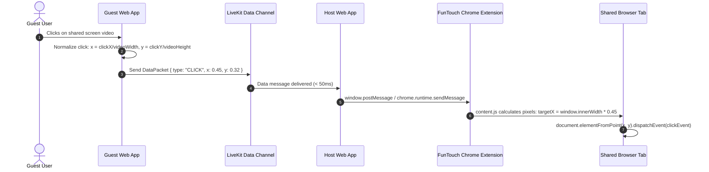

# FunTouch Technical Specification

> **FunTouch** — *Video calls where you can touch the screen.*
>
> **Core Concept:** Host shares a browser tab, guest clicks or types, and the action executes on the host's shared tab in real time.

---

## 1. System Overview & Architecture

FunTouch is composed of four integrated components:

```
┌─────────────────┐        WebSocket / REST        ┌──────────────────────┐
│  React Frontend │ ◄────────────────────────────► │  Spring Boot Backend │
│   (Host/Guest)  │                                │     (Java 21 / 3.4)  │
└────────┬────────┘                                └──────────┬───────────┘
         │                                                    │
         │ WebRTC Media + Data Messages                       │ Issues Access Tokens
         ▼                                                    ▼
┌─────────────────┐                                ┌──────────────────────┐
│  LiveKit Cloud  │ ◄──────────────────────────────┤  LiveKit Server SDK  │
│  (Audio/Video)  │                                └──────────────────────┘
└────────┬────────┘
         │ Host receives guest click coordinates via Data Channel
         ▼
┌─────────────────┐
│ Chrome Extension│ ───► Simulates clicks/scroll/keys in target tab
│  (Manifest V3)  │
└─────────────────┘
```

### Component Roles

| Component | Responsibility | Technology |
|---|---|---|
| **Backend Server** | Room session lifecycle, LiveKit JWT token issuance, host auth, real-time WebSocket notifications | Java 21, Spring Boot 3.4.0, Maven |
| **Frontend Web App** | Landing page, room lobby, video conferencing UI, screen share presentation, guest cursor tracking & click capture | React 18+, Vite, LiveKit Client SDK |
| **Media Service** | WebRTC SFU, TURN/STUN relays, sub-second video streaming, low-latency WebRTC data channels | LiveKit Cloud / Self-hosted LiveKit |
| **Chrome Extension** | Injected content script running in the shared tab; converts relative `(x%, y%)` clicks into real DOM click/keyboard events | Chrome Extensions Manifest V3 (`externally_connectable`, `scripting`) |

---

## 2. Backend Foundation Specification (`server/`)

The backend is packaged under `com.funtouch` with in-memory persistence (`ConcurrentHashMap`) designed for sub-millisecond state access during calls.

### 2.1 Domain Models

#### `Room`
The primary session aggregate root.
* `id` (`String`): 6-character unique identifier (e.g., `abc123`).
* `name` (`String`): Human-readable room title.
* `host` (`Participant`): Participant with `HOST` role.
* `hostToken` (`String`): Secret UUID session token passed via `X-Host-Token` header. Never exposed in public responses.
* `guests` (`Map<String, Participant>`): Map of `guestId` to guest participant records.
* `status` (`RoomStatus`): `WAITING` | `ACTIVE` | `ENDED`.
* `createdAt` (`Instant`): UTC creation timestamp.
* `lastActivityAt` (`Instant`): Timestamp of last activity for expiration tracking.

#### `Participant` (Record)
* `id` (`String`): Unique UUID.
* `displayName` (`String`): 2–50 character participant name.
* `role` (`ParticipantRole`): `HOST` | `GUEST`.
* `guestStatus` (`GuestStatus`): `PENDING` | `APPROVED` | `REJECTED` (applicable to guests).
* `controlState` (`ControlState`): `NONE` | `REQUESTED` | `GRANTED` | `REVOKED`.
* `joinedAt` (`Instant`): Timestamp joined.

---

## 3. REST API Specification

> **Individual API Spec Files:** See the [`room-service/`](room-service/) directory for detailed per-endpoint markdown specifications matching the standard API specification format:
> - [`create-room.md`](room-service/create-room.md) — `POST /api/rooms`
> - [`get-room.md`](room-service/get-room.md) — `GET /api/rooms/{roomId}`
> - [`join-room.md`](room-service/join-room.md) — `POST /api/rooms/{roomId}/join`
> - [`approve-guest.md`](room-service/approve-guest.md) — `POST /api/rooms/{roomId}/approve`
> - [`reject-guest.md`](room-service/reject-guest.md) — `POST /api/rooms/{roomId}/reject`
> - [`update-control.md`](room-service/update-control.md) — `POST /api/rooms/{roomId}/control`
> - [`end-room.md`](room-service/end-room.md) — `DELETE /api/rooms/{roomId}`
> - [`websocket-room-events.md`](room-service/websocket-room-events.md) — `WS /ws`

**Base URL:** `http://localhost:8080/api/rooms` (production: `https://api.funtouch.app/api/rooms`)

### 3.1 Create Room
* **Endpoint:** `POST /api/rooms`
* **Access:** Public
* **Request Body:**
```json
{
  "hostName": "Alice",
  "roomName": "Design Review"
}
```
* **Validation:** `hostName` (not blank, 2-50 chars), `roomName` (optional, max 100 chars).
* **Response Status:** `201 Created`
* **Response Headers:** `X-Host-Token: <uuid-token>` *(Client must store this for subsequent host actions)*
* **Response Body:**
```json
{
  "roomId": "2eb8a8",
  "roomName": "Design Review",
  "roomUrl": "http://localhost:5173/room/2eb8a8",
  "status": "WAITING",
  "hostName": "Alice",
  "guests": [],
  "token": "eyJhbGciOi...",
  "createdAt": "2026-11-08T08:00:00Z"
}
```

### 3.2 Get Room Information
* **Endpoint:** `GET /api/rooms/{id}`
* **Access:** Public (used by guests before joining)
* **Response Status:** `200 OK`
* **Response Body:**
```json
{
  "roomId": "2eb8a8",
  "roomName": "Design Review",
  "roomUrl": "http://localhost:5173/room/2eb8a8",
  "status": "ACTIVE",
  "hostName": "Alice",
  "guests": [
    {
      "guestId": "56f3f3ce-...",
      "displayName": "Bob",
      "guestStatus": "APPROVED",
      "controlState": "GRANTED"
    }
  ],
  "token": null,
  "createdAt": "2026-11-08T08:00:00Z"
}
```

### 3.3 Request to Join Room (Guest)
* **Endpoint:** `POST /api/rooms/{id}/join`
* **Access:** Public
* **Request Body:**
```json
{
  "guestName": "Bob"
}
```
* **Response Status:** `200 OK`
* **Response Body:**
```json
{
  "guestId": "56f3f3ce-ee68-4d49-b30c-6f78f5c8f9db",
  "roomId": "2eb8a8",
  "message": "Join request sent — waiting for host approval"
}
```
* **Side Effect:** Dispatches `GUEST_JOINED` event to `/topic/room/{id}`.

### 3.4 Approve Guest (Host Only)
* **Endpoint:** `POST /api/rooms/{id}/approve`
* **Access:** Protected by `X-Host-Token` header
* **Request Body:**
```json
{
  "guestId": "56f3f3ce-ee68-4d49-b30c-6f78f5c8f9db"
}
```
* **Response Status:** `200 OK`
* **Response Body:**
```json
{
  "guestToken": "eyJhbGciOi...",
  "message": "Guest approved"
}
```
* **Side Effect:** Dispatches `GUEST_APPROVED` event with LiveKit JWT to `/topic/room/{id}`.

### 3.5 Reject Guest (Host Only)
* **Endpoint:** `POST /api/rooms/{id}/reject?guestId={guestId}`
* **Access:** Protected by `X-Host-Token` header
* **Response Status:** `200 OK`
* **Side Effect:** Dispatches `GUEST_REJECTED` event to `/topic/room/{id}`.

### 3.6 Grant or Revoke Remote Control (Host Only)
* **Endpoint:** `POST /api/rooms/{id}/control`
* **Access:** Protected by `X-Host-Token` header
* **Request Body (Grant):**
```json
{
  "guestId": "56f3f3ce-...",
  "action": "grant"
}
```
* **Response Body (Grant):**
```json
{
  "controlState": "GRANTED",
  "controlToken": "eyJhbGciOi...",
  "message": "Control granted"
}
```
* **Request Body (Revoke):**
```json
{
  "guestId": "56f3f3ce-...",
  "action": "revoke"
}
```
* **Side Effect:** Dispatches `CONTROL_GRANTED` or `CONTROL_REVOKED` event to `/topic/room/{id}`.

### 3.7 End Room (Host Only)
* **Endpoint:** `DELETE /api/rooms/{id}`
* **Access:** Protected by `X-Host-Token` header
* **Response Status:** `200 OK`
* **Side Effect:** Sets status to `ENDED` and broadcasts `ROOM_ENDED` event to `/topic/room/{id}`.

---

## 4. WebSocket Protocol Specification

Real-time room events use Spring WebSocket STOMP over SockJS fallback.

* **Connection Endpoint:** `/ws`
* **Subscription Destination:** `/topic/room/{roomId}`
* **Protocol Frame Format:**
```json
{
  "eventType": "GUEST_JOINED | GUEST_APPROVED | GUEST_REJECTED | CONTROL_GRANTED | CONTROL_REVOKED | ROOM_ENDED",
  "roomId": "2eb8a8",
  "participantId": "56f3f3ce-...",
  "participantName": "Bob",
  "guestToken": "eyJhbGci... (only present on GUEST_APPROVED)",
  "controlState": "GRANTED | REVOKED (only on CONTROL_* events)",
  "roomStatus": "ENDED (only on ROOM_ENDED)",
  "message": "Human-readable description"
}
```

---

## 5. LiveKit Video Grants & Security Specification

Tokens are signed using HMAC-SHA256 with `livekit.api-key` and `livekit.api-secret`.

| Role / State | `roomJoin` | `room` | `canPublish` | `canSubscribe` | `canPublishData` |
|---|---|---|---|---|---|
| **Host** | `true` | `{roomId}` | `true` (Webcam, Mic, Screen) | `true` | `true` (Data messages) |
| **Guest (Default)** | `true` | `{roomId}` | `false` | `true` (Watch stream) | `false` |
| **Guest (Controlled)** | `true` | `{roomId}` | `false` | `true` (Watch stream) | `true` (Send click events) |

> **Security Guardrail:** Remote control clicks are transmitted via LiveKit Data Messages. If a malicious client attempts to send clicks without host approval, LiveKit's SFU rejects the packet because `canPublishData` is set to `false`.

---

## 6. Remote Interaction Pipeline (Phases 3 & 4)



### Click Event Payload Schema
```json
{
  "type": "click",
  "x": 0.4523,
  "y": 0.3120,
  "button": "left",
  "timestamp": 1731052800000
}
```

### Move / Cursor Event Payload Schema (Throttled at 30 fps)
```json
{
  "type": "cursor",
  "x": 0.4510,
  "y": 0.3105,
  "guestId": "56f3f3ce-...",
  "guestName": "Bob"
}
```

---

## 7. Safety, Consent & Privacy Guardrails

1. **Explicit Per-Session Consent:** Remote control is never granted automatically. Host must explicitly approve remote control.
2. **Visual Host Banner:** Whenever control is active, the extension injects a high-visibility warning bar atop the controlled tab:
   `[FunTouch] Bob is controlling this tab [Revoke Control (Esc)]`
3. **Emergency Disconnect:** Pressing `Esc` or clicking "Revoke" immediately calls `/api/rooms/{id}/control` with `action: "revoke"` and halts event simulation.
4. **Scope Limitation:** Control is strictly confined to the single shared tab via the Chrome Extension content script; the guest cannot access other tabs, host desktop, or OS files.

---

*Spec Version: 1.0 (Phase 1 Implemented)*
*FunTouch Team — November 2026*

